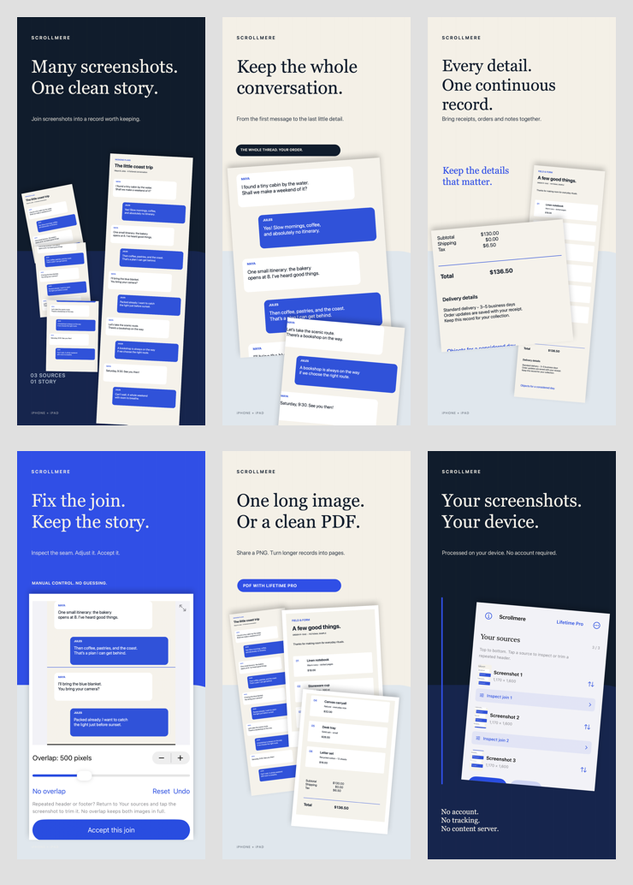
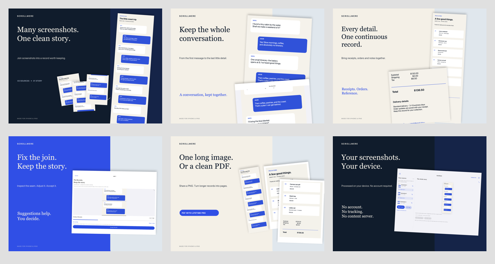

# Scrollmere: Long Screenshot

Many Screenshots. One Clean Story.

**Status: submitted to Apple on September 27, 2026. Version 1.0 (2) and Lifetime Pro are Waiting for Review. Not yet released.**

Public product and engineering showcase by **Sepideh Javanbakht Dalir**. [Website](https://www.arvinify.com) · [Contact](mailto:hello@arvinify.com). Commercial source is private.

Native Universal iPhone/iPad app: Swift, SwiftUI, UIKit, ImageIO, Core Graphics, PDFKit, StoreKit 2. Select, reorder, suggest overlap, inspect and correct joins, preview, export PNG or paginated PDF. Free three-image workflow; one-time Pro adds longer sets and PDF.

Privacy: on-device processing, backup-excluded local originals and draft, no account/ads/tracking or remote analytics. Current runtime and commercial results remain in progress; no superiority or revenue claim.

[Privacy](https://sepidehdalir.github.io/scrollmere-showcase/privacy.html) · [Support](https://sepidehdalir.github.io/scrollmere-showcase/support.html)

## Product campaign

Original fictional conversations and receipts, actual SwiftUI renders, and real app PNG/PDF exports. Separate portrait iPhone and landscape iPad compositions. No private user screenshots.

## Engineering evidence

16 tests passed on iPhone 17 Pro Max / iOS 26.1. Covered draft recovery, original-byte retention, backup exclusion, review gating, grayscale orientation, exact PNG output continuity, 20-source/32-megapixel export and local StoreKit purchase/restore/pending/refund handling. Chat and receipt exports match their full source fixtures pixel for pixel. iPad-sized UI renders were inspected; this is not a claim of iPad hardware execution. App Store sandbox purchase and iOS 15 execution remain unverified.
